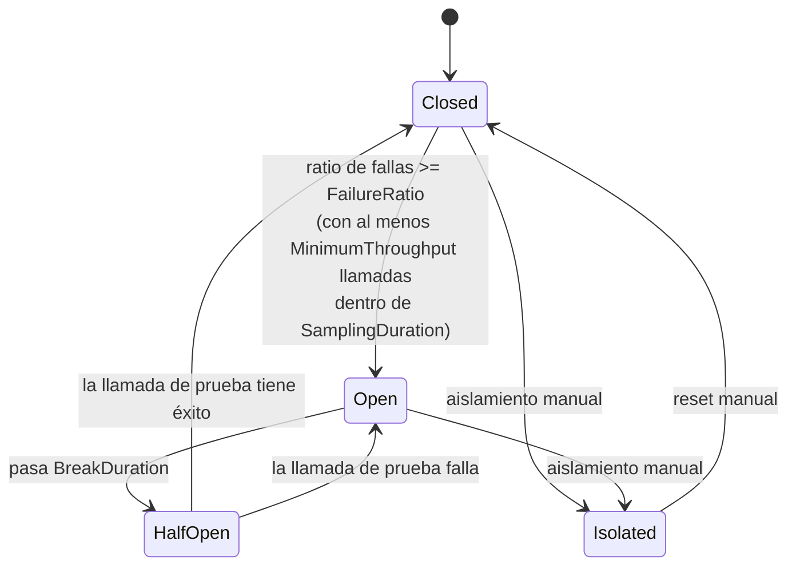
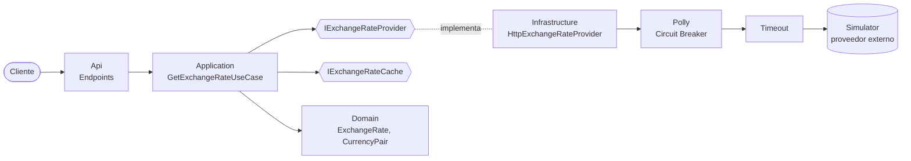

# Circuit Breaker Lab

Laboratorio práctico del patrón **Circuit Breaker** con **.NET 10 (LTS)**, **arquitectura hexagonal** y **Polly v8** (`Microsoft.Extensions.Http.Resilience`).

La API consulta tipos de cambio a un **proveedor externo** (un simulador que puedes "romper" a voluntad). El circuito protege la API cuando el proveedor falla: deja de llamarlo, responde al instante con el último valor conocido y, pasado un tiempo, prueba si ya se recuperó.

---

## ¿Qué es un Circuit Breaker?

Cuando una dependencia externa falla o responde lento, seguir llamándola:

- consume hilos, conexiones y tiempo de espera de tus usuarios;
- satura aún más al servicio que ya está caído;
- propaga la falla en cascada a todo tu sistema.

El Circuit Breaker funciona como el interruptor eléctrico de una casa: **si detecta demasiadas fallas, "salta" y corta las llamadas** durante un tiempo.



| Estado | Qué pasa con las llamadas | ¿Llegan al proveedor? |
|---|---|---|
| **Closed** | Pasan normalmente y se mide el ratio de fallas | Sí |
| **Open** | Se rechazan al instante (`BrokenCircuitException`) | **No** |
| **HalfOpen** | Se permite una llamada de prueba | Solo la de prueba |
| **Isolated** | Abierto manualmente hasta un reset | **No** |

### Configuración del laboratorio (`.env.development`)

| Variable | Valor | Significado |
|---|---|---|
| `CB_FAILURE_RATIO` | `0.5` | Se abre si el 50 % de las llamadas fallan |
| `CB_MINIMUM_THROUGHPUT` | `4` | ...siempre que haya al menos 4 llamadas en la ventana |
| `CB_SAMPLING_DURATION_SECONDS` | `30` | Ventana de medición |
| `CB_BREAK_DURATION_SECONDS` | `15` | Tiempo que permanece abierto |
| `PROVIDER_TIMEOUT_SECONDS` | `2` | Una respuesta más lenta cuenta como falla |

Cuentan como falla: HTTP 5xx, 408, 429, timeouts y errores de red. Un 4xx (por ejemplo, par de monedas inexistente) **no** abre el circuito porque es un error del cliente, no del proveedor.

---

## Arquitectura

```
CircuitBreakerLab/
├── backend/                                  API (arquitectura hexagonal)
│   ├── src/
│   │   ├── CircuitBreakerLab.Domain/         Núcleo: sin dependencias
│   │   │   ├── ExchangeRates/                CurrencyCode, CurrencyPair, ExchangeRate
│   │   │   └── CircuitBreaker/               CircuitState, CircuitEvent, CircuitSnapshot...
│   │   ├── CircuitBreakerLab.Application/    Casos de uso + puertos
│   │   │   ├── Ports/                        IExchangeRateProvider, IExchangeRateCache, ICircuitBreakerMonitor
│   │   │   ├── ExchangeRates/                GetExchangeRate (con fallback)
│   │   │   └── CircuitBreaker/               GetCircuitStatus, ResetCircuit, IsolateCircuit
│   │   ├── CircuitBreakerLab.Infrastructure/ Adaptadores de salida
│   │   │   ├── ExchangeRates/                HttpExchangeRateProvider, InMemoryExchangeRateCache
│   │   │   └── Resilience/                   Pipeline Polly + CircuitBreakerMonitor
│   │   └── CircuitBreakerLab.Api/            Adaptador de entrada (Minimal API)
│   ├── Directory.Build.props                 Configuración común de compilación
│   ├── Directory.Packages.props              Versiones centralizadas de NuGet
│   ├── Dockerfile
│   └── .dockerignore
├── simulator/                                Proveedor externo simulado (controlable)
├── scripts/demo.ps1                          Recorre el ciclo completo del circuito
├── docker-compose.yml
├── .env.example / .env.development
└── .gitignore
```



**Regla de dependencias**: `Api → Application → Domain` e `Infrastructure → Application`. El dominio y los casos de uso no conocen Polly, HTTP ni ASP.NET; el Circuit Breaker es un detalle de infraestructura que se expone a la aplicación a través del puerto `ICircuitBreakerMonitor`.

### Flujo de una consulta

1. `GET /api/exchange-rates?base=USD&target=EUR`
2. El caso de uso valida el par en el dominio (`CurrencyPair.Create`).
3. Llama al puerto `IExchangeRateProvider`. El adaptador HTTP pasa por el pipeline **Circuit Breaker → Timeout**.
4. Si responde: se guarda en caché y se devuelve con `source: "Live"`.
5. Si falla o el circuito está abierto: el adaptador traduce la excepción a `ProviderUnavailableException` y el caso de uso devuelve el **último valor conocido** (`source: "Fallback"`), o `503` con `source: "Unavailable"` si no hay ninguno.

---

## Ejecutar

### Opción A: Docker Compose

```bash
cp .env.example .env          # o usa directamente .env.development
docker compose --env-file .env.development up --build
```

| Servicio | URL |
|---|---|
| API | http://localhost:5080 |
| Documentación interactiva (Scalar) | http://localhost:5080/scalar |
| OpenAPI | http://localhost:5080/openapi/v1.json |
| Simulador | http://localhost:5090/admin/behavior |

### Opción B: Local con .NET 10 SDK

```bash
dotnet run --project simulator
dotnet run --project backend/src/CircuitBreakerLab.Api
```

En local, la configuración se lee de `appsettings.Development.json`; en contenedores, de las variables de entorno definidas en `.env`. `appsettings.json` no contiene valores y las opciones se validan al arrancar (`ValidateOnStart`), así que la API no inicia si falta configuración.

---

## Ver el circuito en acción

### Demo automática

```powershell
./scripts/demo.ps1
```

Salida real del laboratorio:

```
=== 1. Healthy provider: circuit CLOSED, every call reaches the provider ===
  #1  HTTP 200 source=Live        rate=0,917487   circuit=Closed
  ...
=== 2. Provider starts failing: failures are counted until the threshold opens the circuit ===
  #1  HTTP 200 source=Fallback    rate=0,917282   circuit=Closed reason=ErrorResponse
  #2  HTTP 200 source=Fallback    rate=0,917282   circuit=Closed reason=ErrorResponse
  #3  HTTP 200 source=Fallback    rate=0,917282   circuit=Open   reason=ErrorResponse
  #4  HTTP 200 source=Fallback    rate=0,917282   circuit=Open   reason=CircuitOpen
=== 3. Circuit OPEN: calls fail fast, the provider is NOT called, fallback is served ===
  ...
Requests received by the provider during this step: 0
=== 5. HALF-OPEN: a trial call reaches the provider and closes the circuit ===
  #1  HTTP 200 source=Live        rate=0,917742   circuit=Closed
```

Observa el paso 3: con el circuito abierto el proveedor recibe **0 peticiones**. Esa es la protección.

### Paso a paso manual

Usa `backend/src/CircuitBreakerLab.Api/CircuitBreakerLab.Api.http` o Scalar:

1. `GET /api/exchange-rates?base=USD&target=EUR` varias veces → `Live`, circuito `Closed`.
2. `PUT simulator/admin/behavior` con `{ "mode": "Failing" }`.
3. Repite la consulta → `Fallback` con `ErrorResponse`, luego el circuito pasa a `Open` y la razón cambia a `CircuitOpen` (respuesta inmediata).
4. `GET /api/circuit-breaker` → estado, `openUntil`, métricas y eventos.
5. Vuelve el simulador a `Healthy`, espera 15 s y consulta: la llamada de prueba (`HalfOpen`) cierra el circuito.

### Otros experimentos

| Experimento | Cómo | Qué observar |
|---|---|---|
| Proveedor lento | `{ "mode": "Slow", "latencyMs": 5000 }` | Cada llamada corta a los 2 s (`Timeout`) y cuenta como falla |
| Fallas aleatorias | `{ "mode": "Intermittent", "failureRate": 0.6 }` | El circuito se abre y se cierra según el ratio real |
| Proveedor caído | `docker compose stop simulator` | Falla `Unreachable`, el circuito se abre |
| Mantenimiento | `POST /api/circuit-breaker/isolate` | Estado `Isolated` hasta `POST /api/circuit-breaker/reset` |
| Sin respaldo | Consultar un par nunca consultado con el circuito abierto | `503` con `source: "Unavailable"` |

---

## Endpoints

| Método | Ruta | Descripción |
|---|---|---|
| GET | `/api/exchange-rates?base=USD&target=EUR` | Tipo de cambio a través del circuito |
| GET | `/api/circuit-breaker` | Estado, política, métricas y eventos recientes |
| POST | `/api/circuit-breaker/reset` | Cierra el circuito manualmente |
| POST | `/api/circuit-breaker/isolate` | Abre el circuito manualmente |
| GET | `/health` | Health check |

Simulador:

| Método | Ruta | Descripción |
|---|---|---|
| GET | `/rates?base=USD&target=EUR` | Tipo de cambio (según el modo actual) |
| GET | `/admin/behavior` | Modo actual y número de peticiones recibidas |
| PUT | `/admin/behavior` | Cambia el modo: `Healthy`, `Failing`, `Slow`, `Intermittent` |

Monedas soportadas por el simulador: USD, EUR, GBP, JPY, MXN, COP, PEN.

---

## Stack

- .NET 10 LTS, ASP.NET Core Minimal APIs
- Polly v8 vía `Microsoft.Extensions.Http.Resilience`
- OpenAPI nativo + Scalar
- Docker multi-stage con imágenes oficiales de Microsoft, ejecutando como usuario sin privilegios
- Central Package Management, `TreatWarningsAsErrors` y analizadores `latest-recommended`
